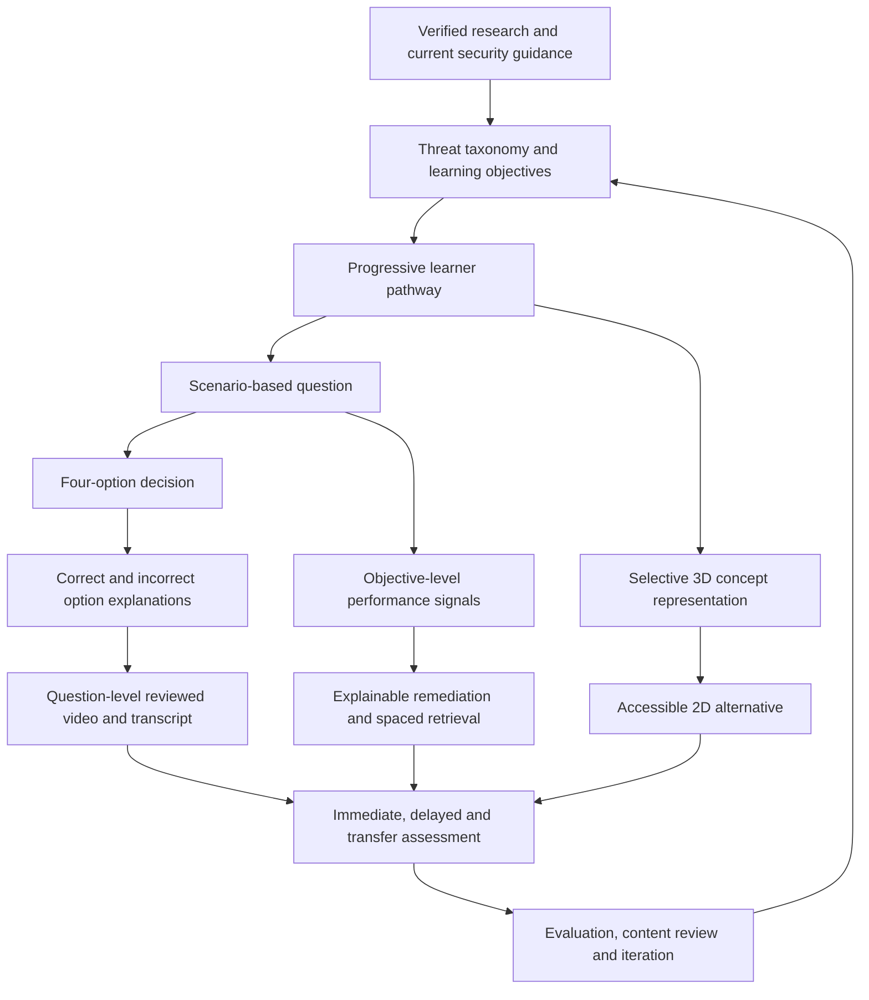
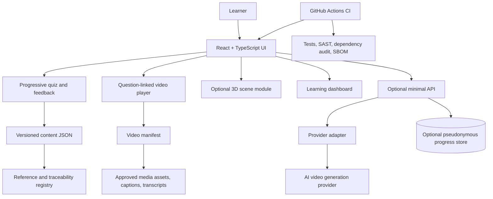

# CyberAware 3D: A Research-Driven AI-Enhanced Framework for Progressive Cybersecurity Awareness Training Through Interactive Three-Dimensional Simulations and Question-Level Educational Videos

**Yogesh Kumar Agrahari**  
Group E — Security Training Design  
[Institution / Department to be confirmed]  
[Email to be added by author]

**Manuscript status:** IEEE-structured research and design manuscript (v0.2), 12 November 2026. This is not an accepted, published or peer-reviewed paper. No CYBERAWARE 3D experiment or implementation result is reported.

## Abstract

Cybersecurity awareness programmes must help learners recognize evolving threats and make safe decisions, yet programme completion and short-term quiz performance do not necessarily demonstrate behaviour change. Prior research describes theory-based security training, anti-phishing education, serious games, augmented and immersive learning environments, and generative-AI-supported educational media. However, the evidence is heterogeneous: a recent scoping review of game-based cybersecurity awareness education identifies varied evaluation practices, while a large 2025 randomized field study reports limited practical value from commonly deployed annual and embedded phishing-training formats. Studies of AI-generated educational videos and generative AI in cybersecurity education identify opportunities alongside concerns about accuracy, hallucination, learner experience and limited evidence of sustained transfer.

This paper proposes **CyberAware 3D**, a research-traceable, progressive cybersecurity-awareness learning framework for non-specialist adult and undergraduate learners. The framework organizes instruction into Beginner, Intermediate and Advanced pathways, with a separate defensive Expert Challenge. It combines scenario-based questions, option-specific explanations, question-level AI-generated explanatory videos, selective browser-based 3D concept visualization, transparent adaptive recommendations, and an auditable citation-to-content traceability model. A 2D alternative, captions, transcripts, reduced-motion support and privacy-conscious fictional simulations are treated as core requirements rather than optional enhancements.

The contribution is a proposed integrated design and evaluation protocol, not a claim of demonstrated effectiveness. A Design Science Research methodology is proposed, with controlled evaluation that separates representation (matched 2D versus 3D) and explanation medium (written explanation alone versus written explanation plus video), measures immediate knowledge, delayed retention and novel-scenario transfer, and reports usability, accessibility and technical performance separately. No empirical results are claimed. The framework is intended to test whether additional modalities provide measurable value beyond well-designed scenario instruction.

**Index Terms—** cybersecurity awareness, security education, phishing, serious games, scenario-based learning, adaptive learning, three-dimensional visualization, generative artificial intelligence, educational video, learning analytics, Design Science Research.

---

## I. INTRODUCTION

People routinely make security-relevant decisions while reading messages, authenticating to services, installing software, sharing files, responding to colleagues and using mobile devices. Attackers exploit not only technical vulnerabilities but also the context in which people interpret requests and decide whether to trust a sender, link, QR code, voice or approval prompt. Cybersecurity education must therefore address more than terminology: it should help learners interpret context, recognize warning signals, choose an appropriate action and transfer that action to unfamiliar situations.

NIST SP 800-50 Rev. 1 frames cybersecurity and privacy education as a lifecycle learning programme that should support behaviour change, security culture, measurement and iterative improvement [1]. This is important because a one-off course-completion record is a weak proxy for whether users can make safer decisions later. Research on information-security awareness distinguishes knowledge, attitudes and behaviour. Parsons et al. report that policy knowledge influences attitudes, while behaviour is a separate construct requiring measurement [4]. Later HAIS-Q validation work found an association between questionnaire scores and performance on a laboratory phishing task, supporting use of both self-report and task-based assessment rather than relying on one metric [5].

The effectiveness of familiar training formats is contested. Puhakainen and Siponen's theory-based action-research intervention supports active cognitive processing and continuous communication in security training [3]. Kumaraguru et al. studied embedded anti-phishing education with attention to retention and transfer [6]. In contrast, Liu et al. analyzed an eight-month randomized experiment involving more than 19,500 employees and ten simulated phishing campaigns; they report that recent annual training completion was not significantly associated with phishing-simulation failure and that embedded training produced very small differences [7]. This result makes it necessary to evaluate learning beyond exposure, attendance and quiz completion.

Game-based cybersecurity education is a mature research area. A 2025 systematic review analyzed 53 studies of cybersecurity serious-game development [8]. A 2026 scoping review included 230 primary studies published in 2018–2024 and applied a taxonomy to 57 games; it documents diverse design and evaluation practices and recommends more standardized testing and comparisons [9]. Augmented and virtual learning environments also appear in the literature [11], [12]. However, evidence for immersive VR cannot be assumed to prove benefits from a browser-based 3D scene on a conventional screen. Similarly, general research on AI-generated teaching videos does not establish that such videos improve cybersecurity decisions.

This paper proposes CyberAware 3D as a traceable learning framework that integrates progressive content, scenario-based assessment, per-question explanatory media, selective 3D visualization, explainable adaptation and evidence-oriented evaluation. The key research position is conservative: these features are hypotheses to test, not benefits to assert in advance.

## II. BACKGROUND AND MOTIVATION

### A. Human factors and cybersecurity learning

Puhakainen and Siponen [3] argue for training that activates and motivates systematic processing of information and is supported by continuous communication. Parsons et al. [4] developed the HAIS-Q to measure knowledge, attitude and behaviour dimensions. In a further validation study, higher HAIS-Q scores were associated with better laboratory phishing-task performance [5]. These findings support an instructional and measurement model in which learners understand both the correct action and its rationale, and in which self-reported awareness is complemented by task performance.

NIST SP 800-50 Rev. 1 [1] recommends a lifecycle approach to learning programmes. CyberAware 3D adopts this by treating question review, content updates, learner feedback and outcome measurement as recurring processes. Its dashboard will present knowledge and engagement signals as learning indicators, not as a definitive real-world risk score.

### B. Phishing, authentication and evolving threats

Phishing and social-engineering scenarios must reflect current authentication practice. NIST SP 800-63B-4 describes phishing resistance as a property of the authentication protocol that protects secrets from impostor verifiers without depending solely on user vigilance. It states that manually entered OTP outputs are not phishing-resistant because the output is not bound to the specific authentication session. The same guidance discusses authentication-fatigue attacks involving repeated push requests that may induce approval [16]. Thus, the curriculum distinguishes OTP confidentiality, push-approval fatigue and phishing-resistant authentication.

The question bank also covers smishing, vishing, QR-code fraud, suspicious attachments, business email compromise (BEC), synthetic-media impersonation, ransomware response, data protection and incident reporting. The operational content is cross-checked against CISA/NSA/FBI phishing guidance [25], FBI BEC advice [26], FTC QR-code guidance [27], NIST incident-response recommendations [28], FBI AI-impersonation advice [29], NSA public-wireless guidance [30], NIST Zero Trust and security-control publications [31], [33], CISA insider-threat resources [32], [38], NIST patch-management guidance [34], joint ransomware guidance [35], NIST PII guidance [36] and NIST supply-chain risk guidance [37]. Scenarios use fictional organizations, identities and credentials; the application does not collect real secrets or conduct real phishing.

### C. Game-based and immersive learning

Ng and Hasan's review of cybersecurity serious-game development reports 53 included papers spanning general knowledge and more specialized security domains [8]. Weeratunge et al. [9] map a larger set of 230 studies and show that research includes game-based and non-game-based education, with evaluation approaches ranging from UX studies to learning tests, comparisons and mixed methods. The review notes some studies have no formal evaluation and recommends standardized tests and control or comparison groups.

An augmented-reality cybersecurity-awareness game, CybAR, has been designed and evaluated by Alqahtani and Kavakli-Thorne [11]. Khan et al. [10] describe a game-based learning platform with a web portal, challenges and a virtual lab. These examples establish that game-based, AR and virtual-lab approaches exist. CyberAware 3D therefore claims integration and traceability as its design contribution, not invention of game-based security education.

Conrad et al.'s systematic review of 30 immersive-VR education studies reports positive results in several learning contexts and points to active engagement and practical application as important [12]. Since immersive head-mounted VR differs from desktop browser-based 3D, CyberAware 3D will test the value of 3D scenes against content-matched 2D representations instead of assuming benefit.

### D. AI-generated explanatory videos

Netland et al. compared human-made and AI-generated teaching videos in an online experiment with 447 participants and four topics. Their study reports similar exam outcomes across conditions and a small learner-experience advantage for human-made videos [13]. Shu et al.'s systematic review of 12 studies describes the multi-stage production pipeline for AI-generated instructional video and notes limitations around motivation and social presence [14]. Arpaci et al. map 60 studies of generative AI in cybersecurity education and identify content generation, phishing-awareness support, assessment, tutoring and cyber-range applications; they also report concerns about hallucination, factual accuracy, bias, overreliance and the limited assessment of sustained learning or authentic-task transfer [15].

The implication is to treat AI video as a reviewed supplementary medium. Each video will be generated from an approved script tied to one question and its written explanation. Captions and transcripts will be available, and a video failure will never remove the text explanation.

## III. RELATED WORK

### A. Theory-based information-security training

Puhakainen and Siponen [3] applied universal constructive instructional theory and the elaboration likelihood model in an action-research security-training programme. Their findings motivate instruction designed for active processing rather than passive content exposure. Parsons et al. [4], [5] provide measurement evidence through the HAIS-Q, including relationships between knowledge/attitude constructs and phishing-task performance.

### B. Anti-phishing education and field efficacy

Kumaraguru et al. [6] studied anti-phishing education designed to gain user attention and examined retention and transfer. The approach motivates contextualized explanations and follow-up testing. However, the 2025 study by Liu et al. [7] found limited practical value for widely deployed annual and embedded training formats in a large healthcare setting. CyberAware 3D consequently proposes delayed and novel-scenario outcome measures, and will not equate training exposure with protection.

### C. Serious games and cybersecurity learning platforms

The 53-study review by Ng and Hasan [8] and 230-study scoping review by Weeratunge et al. [9] describe a wide range of game formats and target populations. Khan et al. [10] present a game-based platform using challenges and a virtual lab. CybAR [11] is an AR awareness game. Google's Be Internet Awesome / Interland provides a public browser game for foundational internet-safety concepts, including detecting fakes, sharing carefully and protecting secrets [22]. Commercial providers also market enterprise security-awareness suites; KnowBe4 describes training, attack simulations, real-time coaching, AI-generated content/video and reporting on its product pages [23]. Commercial descriptions are not used as independent learning-effectiveness evidence.

### D. 3D and AI video evidence

The immersive-VR review [12] is treated as adjacent evidence. It informs the hypothesis that active spatial visualization may help for selected concepts, but does not establish desktop-WebGL effects. AI video findings are also treated cautiously: the experiment by Netland et al. [13] concerns management teaching topics, while the systematic review [14] covers varied education levels and applications. The cybersecurity GenAI mapping study [15] explicitly highlights factuality and transfer limitations.

### E. Research synthesis

Prior work supports individual elements of the proposed platform. The open question is whether their combination, with explicit evidence traceability and robust comparative evaluation, improves learning beyond a well-designed non-3D, text-supported scenario curriculum. This paper does not claim that no such combined platform exists; it states that the initial scoped search did not verify a peer-reviewed system satisfying and evaluating the exact integrated requirements defined here.

## IV. LITERATURE REVIEW AND COMPARATIVE ANALYSIS

**TABLE I — SELECTED LITERATURE COMPARISON**

| Study | Objective / method | Main result or contribution | Limitation / relevance |
|---|---|---|---|
| Puhakainen & Siponen [3] | Theory-based security training; action research | Supports active cognitive processing and continuous communication | Context-specific action research; not proof of this platform |
| Parsons et al. [4] | HAIS-Q development; 500 employees | Knowledge, attitude and behaviour are related but distinct | Self-report and context boundaries |
| Parsons et al. [5] | Two HAIS-Q validation studies; lab phishing task | Higher HAIS-Q scores associated with better phishing-task performance | Reported lab comparison includes 112 students; not long-term behaviour |
| Kumaraguru et al. [6] | Embedded anti-phishing education; retention/transfer focus | Contextual anti-phishing learning approach | Early study and specific task context |
| Liu et al. [7] | Eight-month randomized field experiment; >19,500 employees | Common annual and embedded formats showed limited practical effect | One large healthcare organization and its programme conditions |
| Ng & Hasan [8] | Systematic review, 53 serious-game papers | Maps cybersecurity game design from 2014 to early 2024 | Heterogeneous games and studies |
| Weeratunge et al. [9] | Scoping review, 230 studies; taxonomy applied to 57 games | Maps design audiences and evaluation methods; recommends standardized comparisons | Review keyword and quality-scoring limitations acknowledged |
| Khan et al. [10] | Game-based cybersecurity platform | Web portal, challenges, virtual lab and adapted ARCS model | University/skills context differs from general-awareness audience |
| Alqahtani & Kavakli-Thorne [11] | CybAR AR game; survey evaluation | AR feedback to teach attack consequences | 91-participant survey is limited evidence for durable behaviour |
| Conrad et al. [12] | Systematic review of 30 IVR education studies | Positive effects reported in several active-learning contexts | Immersive VR is not equivalent to desktop WebGL |
| Netland et al. [13] | 447-participant comparison of AI/human teaching videos | Similar exam outcomes; small experience preference for human videos | Management subject matter; external validity for cyber learning unknown |
| Shu et al. [14] | Systematic review; 12 AI-video studies | Describes AI video production pipeline and limitations | Small included evidence base and diverse domains |
| Arpaci et al. [15] | Cybersecurity GenAI mapping; 60 studies | Maps uses and concerns in cybersecurity education | Evidence often short-term, prototype- or quality-focused |

The comparison motivates the project features but also imposes a high evaluation standard. The goal is not to assume that the combination is effective; it is to create a system in which each component and its incremental contribution can be assessed.

## V. RESEARCH GAP

The initial review identifies the following bounded opportunity:

1. Evaluation methods for cybersecurity games vary, and some have no formal evaluation [9].
2. Common annual/embedded training formats can have little effect in practice, as shown in a large field RCT [7].
3. Existing systems demonstrate parts of the proposed concept, including AR awareness [11], challenge-based learning/virtual labs [10], public internet-safety games [22] and enterprise awareness operations [23].
4. AI video and generative AI research show production potential but identify factuality, bias, social-presence and sustained-transfer concerns [13]–[15].
5. Immersive learning evidence is promising but cannot be directly applied to desktop browser-based 3D [12].

The opportunity is therefore an **integrated and auditable framework** that links research references, learning objectives, individual questions, option-specific explanations, question-level videos, learning recommendations and evaluation methods. The initial search did not verify a peer-reviewed implementation that evaluates this exact end-to-end traceability and multimodal configuration; this is a bounded observation, not proof of non-existence.

## VI. PROBLEM STATEMENT

Many cybersecurity-awareness experiences emphasize content completion or isolated assessments, while learners need repeated practice in interpreting context and making safe decisions. The field contains serious games, phishing education, AR/VR learning and AI-supported educational content, but evaluation approaches and reported outcomes vary. There is a need for a progressive, source-traceable learning artefact that enables learners with different prior knowledge to practice defensive decisions and enables researchers to test the incremental value of scenario instruction, 3D visualization, question-level explanatory video and adaptive recommendations.

## VII. RESEARCH QUESTIONS

- **RQ1:** How does a progressive, prior-knowledge-sensitive curriculum affect immediate cybersecurity knowledge and delayed retention compared with fixed sequencing?
- **RQ2:** To what extent do scenario-based decisions with option-specific feedback improve performance on novel defensive decision tasks compared with informational content alone?
- **RQ3:** For which concepts, if any, does browser-based 3D visualization improve understanding or decision performance relative to a content-matched 2D representation?
- **RQ4:** Does a question-specific AI-generated explanatory video, added to the same reviewed written explanation, improve comprehension, delayed recall or perceived clarity compared with written explanation alone?
- **RQ5:** Does explicit citation-to-question-to-explanation-to-video traceability improve auditability and reviewer confidence?
- **RQ6:** Does an explainable adaptive recommendation policy improve learning efficiency or remediation compared with fixed progression?
- **RQ7:** What security, privacy, accessibility, usability and performance constraints arise in a browser-first, AI-assisted cybersecurity education platform?
- **RQ8:** Which measures best distinguish engagement and quiz performance from retained knowledge and transfer to unfamiliar scenarios?

## VIII. RESEARCH OBJECTIVES

1. Develop a research-backed threat and learning-objective taxonomy.
2. Create Beginner, Intermediate and Advanced pathways plus a defensive Expert Challenge.
3. Provide scenario-based multiple-choice decisions with explanations for the correct and incorrect options.
4. Maintain source-to-question-to-explanation-to-video traceability.
5. Provide one question-specific explanatory video asset or explicit generation status for each question.
6. Implement 3D concept visualizations only where spatial representation is useful, with a complete 2D alternative.
7. Design a transparent adaptive recommendation policy.
8. Implement privacy-aware synthetic scenarios and secure software-development controls.
9. Evaluate usability, learning, delayed retention, transfer, accessibility and performance separately.

## IX. PROPOSED CONCEPTUAL FRAMEWORK

The framework links evidence, curriculum design, individual learning decisions, feedback, optional media and measurement.

The framework assumes that media are instructional supports and not substitutes for accurate explanation. The video is attached to a question's explanation record; it is not independently authored or mapped without a canonical question ID.

## X. RESEARCH METHODOLOGY

### A. Design Science Research

The project adopts the six-activity Design Science Research Methodology of Peffers et al. [2]: problem identification, objective definition, design/development, demonstration, evaluation and communication. As of 12 November 2026, the research foundation, 45-item content draft and a dependency-free client-side demonstrator have been prepared. The demonstrator has automated unit/data/server tests, but visual browser E2E, manual accessibility review, expert content approval and outcome evaluation remain outstanding. The artefact is therefore implemented as a formative local prototype, not a production deployment or evaluated intervention.

### B. Research scope and search strategy

The initial search covers cybersecurity awareness, phishing, social engineering, security games, immersive learning, AI-generated educational video, adaptive learning, cybersecurity learning analytics, secure development and accessibility. It prioritizes IEEE Xplore, ACM Digital Library, SpringerLink, ScienceDirect and Google Scholar-style discovery, supplemented by NIST, CISA, ENISA, OWASP and W3C official material. The current manuscript uses a rapid scoping synthesis rather than claiming a complete PRISMA review. Search strings and limitations are documented in the accompanying search log.

### C. Design and development

Requirements will be mapped to learning objectives and stable IDs. A human reviewer will verify security claims and scenario realism. Learning-design review will assess whether question difficulty and answer rationales align to the stated level. Video scripts will be generated only from approved content, followed by human review, captioning and transcript checks.

### D. Demonstration

The system will use fictional identities, simulated messages and synthetic credentials. Demonstrations will not send deceptive messages to third parties, harvest credentials or execute attacks.

### E. Evaluation plan

A formative pilot will test usability, clarity, accessibility, question quality and media reliability. The research questions require several comparisons rather than one overloaded experiment. First, a scenario-instruction study should compare content-matched information-only material with scenario-based decisions and option-specific feedback (RQ2). Second, among scenario-based instruction conditions, a 2 × 2 factorial design should compare (i) content-matched 2D versus browser-based 3D representation and (ii) written explanation versus written explanation plus question-level video (RQ3–RQ4). Third, progressive sequencing and adaptive recommendations should be compared with fixed sequencing and fixed progression, respectively, after item difficulty and content are sufficiently calibrated (RQ1 and RQ6). RQ5 can be assessed in a structured expert audit by measuring source-verification time, citation coverage, defect detection and reviewer confidence with and without the traceability view. RQ7 is addressed through security, privacy, accessibility, usability and performance audits.

Assessments should include baseline knowledge, immediate post-test, delayed retention and novel scenario transfer. Sample size must be established by a priori power analysis for each primary comparison; distinct experiments should not be combined post hoc. Quantitative analysis may use baseline-adjusted regression/ANCOVA and repeated-measures models, with effect sizes and confidence intervals. Qualitative feedback should cover clarity, trust, cognitive load and perceived usefulness. Usability, engagement, learning and transfer must be reported as separate constructs.

### F. Ethics and privacy

Human-subject research requires applicable institutional review or exemption and informed consent. Data collection should be minimized and pseudonymized. The system must not collect real passwords, OTPs, recovery codes, session tokens or financial data. Learner analytics must not be used for high-stakes employment or disciplinary decisions. AI content requires accuracy, bias, privacy, licensing and disclosure review.

## XI. SYSTEM REQUIREMENTS

### A. Functional requirements

The initial functional requirements are: (FR1) present Beginner, Intermediate and Advanced pathways plus a separately labelled defensive Expert Challenge; (FR2) deliver topic-based scenarios and four-option questions; (FR3) record selected answers and calculate item- and topic-level performance; (FR4) show feedback for the correct option and each distractor; (FR5) display the question's evidence references; (FR6) resolve a stable question-to-explanation-to-video mapping; (FR7) provide captions, transcript and accessible playback controls; (FR8) recommend revision and subsequent learning based on transparent rules; (FR9) display progress and learning history; and (FR10) provide a 2D path when 3D is unavailable, unwanted or inaccessible.

### B. Non-functional requirements

The system shall prioritize factual correctness, privacy, availability, responsive performance, maintainability, auditability and accessibility. It shall not request real passwords, one-time passwords, recovery codes, session tokens or banking details. Simulations shall use synthetic identities and fictional artifacts. AI-produced content shall not be published without human review. Core instructional content must remain usable without WebGL, audio or a video-generation provider.

### C. Content integrity requirements

Every item shall have a stable ID, objective, source list, explanation ID, video ID and review status. References must be checked against publisher or standards-body records. Each educational claim should map to one or more sources that support that specific claim. Where evidence is indirect (for example, immersive-VR findings applied to a browser-based 3D scene), the limitation must be explicit. A question's existence in the traceability matrix does not mean that its full stem, choices, rationales or video asset are complete.

## XII. PROPOSED SYSTEM ARCHITECTURE

The proposed architecture is a modular client application with static, versioned instructional content and a replaceable media-generation service boundary. The initial demonstrator can run without user accounts or a database. Local session state may support a demonstration, while persistent accounts and cross-device analytics should be added only when a justified research or operational requirement exists.

**Client layer (target and current implementation are distinct).** The target architecture specifies React and TypeScript for the learning paths, quiz, explanation panel, research references, dashboard and settings, with optional Three.js/React Three Fiber scenes isolated from the semantic 2D interface. The currently verified executable demonstrator is the dependency-free browser-native ES-module application with semantic HTML/CSS, a Node.js static server and procedural WebGL scenes; the React + TypeScript + Vite migration source is present but is not yet an accepted, dependency-installed production build. All core learning tasks in the demonstrator are available through standard HTML controls.

**Content layer.** Version-controlled JSON contains questions, answer options, rationales, learning objectives and reference identifiers. A separate video manifest maps every question ID to a video status, script location, caption file, transcript and optional media file. Referential integrity is checked automatically.

**Service layer.** A minimal Node.js API is optional for a static demonstration. When persistence or video generation is required, the API provides authenticated endpoints, strict schema validation, rate limits, structured errors and provider-independent adapters. AI provider credentials remain in server-side environment or secret storage. No secret is delivered to the browser.

**Data layer.** The baseline demonstrator uses static JSON and non-sensitive client-side progress. If persistence is required, store pseudonymous learner IDs, assessment events and progress with retention controls. Avoid storing free-text personal data. Keep research datasets separated from operational product telemetry.

**Delivery and security layer.** Git-based CI performs dependency installation, formatting/linting, type checking, unit/integration tests, production build, secret scanning, dependency auditing and SBOM generation. Production deployment should use TLS, restrictive security headers, least-privilege identities and reviewed release artifacts. The workflow design should be coordinated with Group E's shared CI work rather than duplicating it.

**Figure 1. Proposed logical architecture (content and media paths).**

**Figure 2. Content production and review workflow.**

### A. API and data contracts

The question schema should include `questionId`, `level`, `category`, `objectiveId`, `scenario`, `prompt`, four `options`, `correctOptionId`, `rationales`, `referenceIds`, `explanationId`, `videoId`, `takeaway`, `defensiveAction`, `estimatedSeconds`, `status` and `contentVersion`. The video manifest should include `videoId`, `questionId`, `status`, `scriptPath`, `storyboardPath`, `transcriptPath`, `captionsPath`, optional `mediaPath`, `durationSeconds`, `provider`, `generationTimestamp` and `reviewStatus`. Status values must distinguish `script_pending`, `script_ready`, `generation_queued`, `generated_unreviewed`, `validated` and `unavailable`.

A manifest validator shall reject duplicate IDs, missing question references, invalid difficulty labels, non-four-option items, missing rationales and dangling reference IDs. A media validator shall reject a `validated` status when the referenced file does not exist or cannot be decoded.

## XIII. PROGRESSIVE LEARNING MODEL

The instructional sequence uses three principal levels and an optional expert challenge. Beginner items focus on recognition and safe first actions; Intermediate items require contextual interpretation and multi-step decisions; Advanced items require risk prioritization, organizational judgment and incident response. The Expert Challenge is not represented as a fourth mandatory progression tier, and access should not imply professional certification.

The currently implemented progression rule is a provisional product heuristic: a learner may enter the next core level after at least ten distinct first attempts in the preceding level and at least 75% first-attempt accuracy. The separate Expert Challenge uses the same 10-attempt/75% threshold over Advanced first attempts. Topic review is recommended only after at least two distinct first-attempt items in the topic and accuracy below 70%. These rules do not include a hidden critical-misconception override, are configurable implementation choices rather than validated mastery cut-offs, and must not be interpreted as proof of real-world competence. The evaluation should compare alternative thresholds and inspect high-risk misconception patterns separately.

Feedback is delivered after each answer or at a controlled checkpoint depending on the selected learning mode. In practice mode, immediate feedback supports correction; in assessment mode, answer rationales may be deferred until the end to reduce cueing. Repeated attempts should use varied question forms and transfer scenarios rather than merely repeat identical items.

## XIV. INTERACTIVE THREE-DIMENSIONAL LEARNING FRAMEWORK

3D is used selectively to make spatial or relational concepts visible: a network trust boundary, an attack-surface map, a progression environment or the flow of an authentication request. It is not used as the sole representation of textual warnings, answer choices or critical instructions. Each scene must have a semantically equivalent 2D diagram or text description.

**Implemented in the current demonstrator:** a procedural WebGL globe illustration with a non-WebGL 2D fallback, plus four defensive learning simulations covering phishing inspection, password-profile configuration, MFA-fatigue response and ransomware incident-response sequencing. The simulation decision models use fictional data and are linked to learning objectives, questions and research references. The scenes are educational illustrations rather than live network or threat-intelligence visualizations. **Not yet represented as completed features:** a fully navigable 3D learning world with floating portals, a live holographic threat map, production-grade network telemetry visualizations, and a fully integrated 3D achievement environment. These remain design opportunities rather than shipped functionality.

A browser-based 3D experience is not equivalent to immersive virtual reality. The immersive-VR systematic review provides motivation to test engagement and learning effects, but direct claims about this platform require a 2D-matched evaluation [12]. Performance acceptance criteria should be device-aware: no required instructional task may depend on a high-end GPU; frame-rate, load time, memory and fallback behaviour should be measured on representative low-, mid- and high-range devices.

## XV. AI VIDEO EXPLANATION FRAMEWORK

Each question is assigned a unique video ID and a production record. The video explains the scenario, the correct response, why each alternative is unsafe or incomplete, the concept involved, the defensive action and the key takeaway. The accompanying written explanation remains authoritative and available when media is missing or inaccessible.

The production pipeline is: approved question and evidence → versioned script → scene storyboard → visual prompt and narration → provider adapter → video generation → human security review → caption and transcript review → technical playback validation → manifest publication. The script must cite the same evidence used by the question. AI-generated narration or visuals must not fabricate interfaces, logos, authoritative warnings or incident evidence. Simulated interfaces must be labelled as fictional where confusion is plausible.

The AI-video literature includes an experimental comparison in a non-cybersecurity teaching context reporting comparable examination outcomes between human-made and AI-generated videos, with some preference for human-made material [13]. A 2025 review of AI-generated instructional videos identifies a multi-stage generation workflow and issues such as learner motivation and social presence [14]. A 2026 systematic mapping study of generative AI in cybersecurity education identifies possible uses while highlighting hallucination, factual reliability, bias and limited evidence of sustained learning transfer [15]. These sources support investigating an AI-assisted production pipeline; they do not prove that an AI-generated video per quiz item improves cybersecurity awareness.

No generated video is included in this research-first release. Video scripts, storyboards and assets are a later content-production phase. Every manifest entry must remain explicitly pending until a real file has been generated, reviewed and validated.

## XVI. RESEARCH-BACKED QUESTION BANK

The current content release contains 45 authored scenario questions: 15 Beginner, 15 Intermediate and 15 Advanced. Each item has a unique ID, category, learning objective, scenario, four answer options, one answer key, four option-specific rationales, numbered references, a takeaway, a defensive action, a completion-time estimate, and matching explanation/video identifiers. The package also contains 45 draft narration scripts, storyboards, generation prompts and WebVTT caption drafts. These materials have passed structural consistency checks but remain pending independent cybersecurity subject-matter and instructional-design approval. No MP4 has been generated, and no question has been validated with learners.

Questions should assess decisions rather than memorization wherever possible. Distractors must represent plausible but unsafe or incomplete actions without teaching operational attack procedures. Each claim in a rationale should be linked to the relevant source; references are not decorative citations. Where a claim is based on a standard or official guidance, indicate the issuing body and version so that content can be reviewed when guidance changes.

## XVII. ADAPTIVE ASSESSMENT AND LEARNING ANALYTICS

The initial recommendation mechanism is transparent and rule-based. For topic \(t\), accuracy is:

\[
A_t = \frac{C_t}{N_t}
\]

where \(C_t\) is the number of correct responses and \(N_t\) is the number of attempted items in that topic. Overall accuracy is calculated analogously over all attempted items. A topic-level gap in the current demonstrator is flagged only after at least two distinct first-attempt items and when \(A_t\) is below 70%. Level progression is separate: the current provisional implementation uses at least 75% first-attempt accuracy across at least ten distinct first attempts in the preceding level; the Expert Challenge applies that rule to Advanced first attempts. These are configurable starting parameters, not validated mastery cut-offs. Recommendations prioritize the lowest-scoring sufficiently sampled topics and present a linked explanation and subsequent practice item.

A simple weighted score may be reported for navigation, but it should not be described as a validated estimate of real-world security competence. Low sample counts should produce an “insufficient evidence” state rather than a confident diagnosis. Recent performance can be displayed as a trend, but recency weighting must be documented and tested for stability. Adaptive recommendations should explain why they appear and permit the learner to choose a different topic.

The dashboard should separate knowledge checks, practice activity, media engagement and technical telemetry. Video completion, time-on-task and XP are engagement indicators, not direct evidence of learning or behaviour change. No employment, disciplinary or high-stakes inference should be drawn from these indicators.

## XVIII. IMPLEMENTATION METHODOLOGY AND TECHNOLOGY DECISIONS

The target implementation stack remains React, TypeScript and Vite for the client; Three.js with React Three Fiber for optional browser 3D; and a utility-first or component-based design system for responsive styling. The current local demonstrator uses dependency-free browser ES modules, semantic HTML/CSS, a small WebGL visualization and a Node.js static server because dependency installation was unavailable in the build environment. This is a documented temporary stack deviation, not a completed React/Vite implementation. Static JSON is the initial content store. A small Node.js API should be introduced only for provider calls or persistence. A relational database such as PostgreSQL is justified only if accounts, multi-device progress, role-based administration or formal evaluation data require persistence.

The AI provider interface should expose operations such as `createVideoJob`, `getVideoJobStatus` and `retrieveVideoAsset`, with provider-specific adapters isolated server-side. Generation should be asynchronous at the service level; the frontend reads status and handles unavailable or delayed media gracefully. Credentials must be stored in managed secrets or protected environment variables and never committed to source control or returned by API responses.

The current formative implementation includes the canonical question and explanation data, accessible 2D quiz flow, video manifest and script fallback, local progress, rule-based recommendations, dashboard, a WebGL globe with a 2D fallback, automated Node tests, a content validator, a narrow secret scan, static distribution and CycloneDX SBOM generation. Remaining work includes React/TypeScript/Vite migration, complete browser E2E and visual testing, WebGL runtime verification, manual WCAG review, actual MP4 generation/validation, human expert review and formal evaluation. This order protects the learning functionality from being blocked by 3D or external AI dependencies.

## XIX. SECURITY AND PRIVACY CONSIDERATIONS

The application is itself a security-sensitive educational system. Its threat model includes unauthorized access to learner records, injection through content or API inputs, compromised dependencies, accidental secret exposure, malicious uploads, insecure provider integration, cross-site scripting, misconfigured security headers and analytics over-collection. Applicable secure-development practices should be drawn from NIST SSDF [18], NIST CSF 2.0 [17] and OWASP Top 10:2025 [19].

Controls include schema-based input validation, output encoding, restrictive content security policy, TLS, least privilege, secure cookie settings if sessions are used, rate limiting, dependency pinning and auditing, secret scanning, SBOM generation, logging without sensitive content, safe error messages and tested backup/retention procedures. If user accounts are introduced, use a well-reviewed identity provider or established authentication library rather than custom password-handling code. The learning platform must never solicit actual credentials as part of a simulation.

Authentication guidance in content should reflect current standards. NIST SP 800-63B-4 addresses phishing-resistant authentication and describes push-notification fatigue risks; manually entered OTPs are not phishing-resistant, while verifier name binding in WebAuthn provides phishing resistance [16]. User-facing explanations must avoid overgeneralizations such as “MFA always prevents account takeover.”

## XX. ACCESSIBILITY AND INCLUSIVE DESIGN

The design target is WCAG 2.2 AA, subject to validation against the applicable conformance requirements [20]. All critical content and tasks must work with keyboard navigation and screen readers. Use semantic headings, landmarks, labels, visible focus, sufficient contrast, non-colour cues, captions, transcripts and appropriately announced feedback. Do not rely on spatial navigation or drag-only controls in 3D scenes.

Reduced-motion preferences should disable non-essential motion, and users should be able to pause animated scenes. Provide a 2D equivalent for every instructional 3D activity. Videos must not autoplay with sound. Captions should identify meaningful non-speech audio when present. Transcripts should include spoken content and relevant visual information. Accessibility testing should involve automated checks plus manual keyboard and assistive-technology review; automated scans alone cannot establish WCAG conformance.

## XXI. EVALUATION METHODOLOGY

Evaluation is planned, not performed. The research should use a staged protocol:

1. **Expert content review:** cybersecurity practitioners and learning-design reviewers assess factual accuracy, ambiguity, distractor quality, level appropriateness, citation validity and defensive safety.
2. **Formative usability pilot:** a small pilot identifies confusing wording, navigation barriers, media failures and accessibility defects. Pilot data should not be presented as an effectiveness trial.
3. **Controlled learning evaluation:** run staged, adequately powered comparisons. For RQ2, compare information-only content with scenario-based decisions and option-specific feedback. For RQ3–RQ4, within scenario-based instruction, use a 2 × 2 factorial comparison of matched 2D versus browser-based 3D and written explanation alone versus written explanation plus question-level video. For RQ1 and RQ6, conduct separate comparisons of progressive versus fixed sequencing and adaptive versus fixed recommendations. For RQ5, run an expert audit comparing the traceability view with a conventional content view, measuring source-verification time, reference coverage, detected defects and reviewer confidence. Random assignment is preferable where feasible; keep content, objectives, difficulty, time exposure and scoring consistent within each comparison.
4. **Transfer and retention assessment:** measure baseline knowledge, immediate post-test, delayed retention (for example, after two to four weeks) and performance on novel scenarios. The primary outcome should be defined before data collection; a reasonable candidate is accuracy on an unseen scenario-based decision test.
5. **Implementation evaluation:** measure completion, abandonment, task time, playback failures, caption availability, browser compatibility, accessibility defects, load time and 3D rendering performance.

A priori power analysis should determine sample size based on a defensible minimum effect of interest, expected variance, statistical power and attrition. Report effect sizes and confidence intervals, not only p-values. If randomization is not possible, explain the quasi-experimental design and address selection bias. Avoid comparing different content sets across conditions, as this would confound the effect of medium with content.

Potential analyses include baseline-adjusted regression/ANCOVA for post-test outcomes, mixed-effects models for repeated measures, and logistic regression for item-level decisions. Report subgroup analyses only when justified and adequately powered. Qualitative interviews or open responses can explain usability and trust but should not substitute for behavioural outcome measures. A measure of real-world behaviour would require a separate ethical protocol and should not use deceptive or unauthorized phishing.

## XXII. RESULTS AND DISCUSSION

No empirical learning results are available for CyberAware 3D as of this manuscript version. A locally runnable, dependency-free web demonstrator has been implemented with level navigation, a question/feedback flow, local progress, transparent recommendations, a research-reference panel, dashboard and achievements. It includes a procedural WebGL globe with a 2D fallback and four fictional defensive simulations (phishing inspection, password-profile configuration, MFA-fatigue response and ransomware incident-response sequencing). Forty-five core question drafts (15 per Beginner, Intermediate and Advanced level) plus six separate Expert Challenge scenarios, 51 linked explanations, 204 option-specific rationales, narration scripts, storyboards, visual prompts and WebVTT caption drafts are packaged and structurally validated. The React + TypeScript + Vite migration exists as source and has domain/source tests, but its dependency installation and production build remain gated. Automated content, unit, static-build and HTTP smoke checks have been run. These are implementation and content-QA observations only; they are not learner outcomes or evidence of educational effectiveness. Human cybersecurity/learning-design approval, full browser E2E, manual accessibility testing and participant evaluation remain outstanding. No MP4 video assets have been generated or validated.

The literature motivates the design but cautions against assuming that more training exposure, gamification, 3D visualization or AI-generated media automatically improves behaviour. The planned evaluation is intended to isolate the incremental contribution of scenarios, 3D and video over content-matched learning. A null or negative result would be meaningful: it may indicate that added media increases cost or cognitive load without improving transfer, in which case the simpler accessible 2D experience should remain the default.

## XXIII. LIMITATIONS

This manuscript is an initial research and design artefact. Its literature synthesis is rapid and scoped, not a completed systematic review with exhaustive database coverage and dual-reviewer screening. The 45 question items, explanations, narration scripts, storyboards, generation prompts and captions are drafts pending expert review; they should not be treated as approved educational content. No MP4 videos have been generated. The implemented application is a dependency-free static demonstrator rather than the proposed React/TypeScript/Vite production architecture; it has not undergone a complete cross-browser or manual WCAG 2.2 AA audit. Automated tests and HTTP smoke checks do not establish usability or learner effectiveness. No human-subject evaluation has been conducted. Some adjacent evidence concerns immersive VR or non-cybersecurity teaching videos and cannot be generalized directly to browser-based 3D cybersecurity learning. Commercial product descriptions are vendor statements rather than independent comparative evaluations. The current adaptive thresholds are transparent prototype rules, not validated mastery cut-offs, and require pilot calibration.

## XXIV. THREATS TO VALIDITY

**Construct validity:** Quiz accuracy may not represent actual secure behaviour. Engagement metrics and self-reports must remain distinct from observed decision performance.

**Internal validity:** Differences in content, time-on-task, prior experience, instructor support or device quality could confound media comparisons. Matched content, random assignment where feasible and preregistered outcomes are proposed mitigations.

**External validity:** A convenience sample of university learners may not represent employees, older adults, public-sector staff or the general public. The first target population must be stated, and replication across populations is needed.

**Conclusion validity:** Small samples, multiple outcomes and subgroup comparisons can produce unstable findings. A priori power analysis, confidence intervals, multiplicity controls and transparent reporting are required.

**Measurement validity:** Delayed assessments may suffer attrition, and simulated scenarios may not reproduce real-world stakes. Novel transfer items and transparent reporting of missing data are proposed.

**Content validity:** Cybersecurity guidance changes. Each claim should have a versioned source, review date and designated content owner.

## XXV. ETHICAL CONSIDERATIONS

The project must obtain institutional ethics review or an exemption determination before recruiting participants or collecting research data, as applicable. Participation should be voluntary and based on informed consent. Avoid collecting directly identifying data unless essential. Use pseudonymous study identifiers, restricted access and documented retention/deletion schedules. Participants should not be shamed or ranked publicly for mistakes.

All threat simulations must be fictional, safe and bounded. No real phishing, credential harvesting, malware execution or unauthorized system testing is permitted. The content must not provide operational instructions that facilitate abuse. AI-generated assets require review for factual accuracy, stereotypes, misleading depictions and rights/licensing. The paper and preprint must disclose material AI assistance in accordance with the selected venue's current policy; AI systems should not be listed as authors unless the venue explicitly permits it.

## XXVI. CONCLUSION

This paper has proposed CyberAware 3D, a research-traceable framework for progressive cybersecurity-awareness education that combines scenario-based quizzes, option-specific explanations, question-level explanatory video, optional 3D visualization and transparent adaptive recommendations. The literature supports the importance of lifecycle learning, active instruction, retention and transfer measurement, and careful evaluation of game-based and AI-supported educational formats. It does not establish that the proposed combination is effective.

The principal contribution is a testable architecture and traceability model connecting evidence, learning objectives, questions, explanations, media assets and evaluation methods. The project should proceed by validating its content and accessibility, implementing the accessible 2D learning path first, adding optional media and 3D in a controlled manner, and evaluating retention and novel-scenario transfer before making effectiveness claims.

## XXVII. FUTURE RESEARCH

Future work should complete and preregister the systematic literature review; obtain cybersecurity and learning-design expert review of all 45 question drafts; revise their difficulty and distractor quality; produce and validate the 45 question-linked video assets; complete browser and manual accessibility testing; migrate the demonstrator to the target React/TypeScript/Vite architecture if project constraints permit; and conduct the planned controlled evaluation. Further studies should examine long-term retention, transfer across organizational contexts, effects for learners with different accessibility needs, AI-content review workflows, cost-effectiveness and whether adaptive recommendations outperform fixed curricula. Replication in non-academic populations and real organizational settings should follow only with appropriate governance and ethical approval.

## REFERENCES

[1] M. Merritt, S. Hansche, B. Ellis, K. Sanchez-Cherry, J. Nethery Snyder, and D. Walden, *Building a Cybersecurity and Privacy Learning Program*, NIST Special Publication 800-50 Rev. 1, Sep. 2024, doi: 10.6028/NIST.SP.800-50r1.

[2] K. Peffers, T. Tuunanen, M. A. Rothenberger, and S. Chatterjee, “A Design Science Research Methodology for Information Systems Research,” *Journal of Management Information Systems*, vol. 24, no. 3, pp. 45–77, 2007, doi: 10.2753/MIS0742-1222240302.

[3] P. Puhakainen and M. Siponen, “Improving Employees' Compliance Through Information Systems Security Training: An Action Research Study,” *MIS Quarterly*, vol. 34, no. 4, pp. 757–778, 2010, doi: 10.2307/25750704.

[4] K. Parsons, A. McCormac, M. Butavicius, M. Pattinson, and C. Jerram, “Determining employee awareness using the Human Aspects of Information Security Questionnaire (HAIS-Q),” *Computers & Security*, vol. 42, pp. 165–176, 2014, doi: 10.1016/j.cose.2013.12.003.

[5] K. Parsons, D. Calic, M. Pattinson, M. Butavicius, A. McCormac, and T. Zwaans, “The Human Aspects of Information Security Questionnaire (HAIS-Q): Two further validation studies,” *Computers & Security*, vol. 66, pp. 40–51, 2017, doi: 10.1016/j.cose.2017.01.004.

[6] P. Kumaraguru, Y. Rhee, S. Sheng, S. Hasan, A. Acquisti, L. F. Cranor, and J. Hong, “Getting users to pay attention to anti-phishing education: evaluation of retention and transfer,” in *Proc. 2nd Annual eCrime Researchers Summit*, 2007, pp. 70–81, doi: 10.1145/1299015.1299022.

[7] L. Liu, G. Ho, A. Mirian, E. Luo, K. Tong, E. Lee, C. A. Longhurst, C. Dameff, S. Savage, and G. M. Voelker, “Understanding the Efficacy of Phishing Training in Practice,” in *Proc. IEEE Symposium on Security and Privacy*, 2025, pp. 37–54, doi: 10.1109/SP61157.2025.00076.

[8] C. Y. Ng and M. K. B. Hasan, “Cybersecurity serious games development: A systematic review,” *Computers & Security*, vol. 150, Art. no. 104307, 2025, doi: 10.1016/j.cose.2024.104307.

[9] N. H. Weeratunge, R. Hjelsvold, and B. Katt, “A systematic scoping review on game-based cybersecurity awareness education,” *International Journal of Information Security*, vol. 25, Art. no. 71, 2026, doi: 10.1007/s10207-026-01239-9.

[10] M. A. Khan, A. Merabet, S. Alkaabi, and H. El Sayed, “Game-based learning platform to enhance cybersecurity education,” *Education and Information Technologies*, vol. 27, no. 4, pp. 5153–5177, 2022, doi: 10.1007/s10639-021-10807-6.

[11] H. Alqahtani and M. Kavakli-Thorne, “Design and Evaluation of an Augmented Reality Game for Cybersecurity Awareness (CybAR),” *Information*, vol. 11, no. 2, Art. no. 121, 2020, doi: 10.3390/info11020121.

[12] M. Conrad, D. Kablitz, and S. Schumann, “Learning effectiveness of immersive virtual reality in education and training: A systematic review of findings,” *Computers & Education: X Reality*, vol. 4, Art. no. 100053, 2024, doi: 10.1016/j.cexr.2024.100053.

[13] T. Netland, O. von Dzengelevski, K. Tesch, and D. Kwasnitschka, “Comparing human-made and AI-generated teaching videos: An experimental study on learning effects,” *Computers & Education*, vol. 224, Art. no. 105164, 2025, doi: 10.1016/j.compedu.2024.105164.

[14] J. Shu et al., “AI-Generated Instructional Videos: A Systematic Review of Learning Impacts, Applications, and Research Perspectives,” in *Proc. 7th International Conference on Computer Science and Technologies in Education (CSTE)*, 2025, doi: 10.1109/CSTE64638.2025.11091997.

[15] M. Arpaci, M. Khan, A. Qayyum, and M. Baloglu, “Generative AI and Cybersecurity Education, Training, and Awareness: A Systematic Mapping Study,” *IEEE Access*, vol. 14, pp. 150806–150827, 2026, doi: 10.1109/ACCESS.2026.3738195.

[16] D. Temoshok et al., *Digital Identity Guidelines: Authentication and Authenticator Management*, NIST Special Publication 800-63B-4, 2025, doi: 10.6028/NIST.SP.800-63B-4.

[17] M. P. Pascoe, S. Quinn, and K. Scarfone, *The NIST Cybersecurity Framework (CSF) 2.0*, NIST Cybersecurity White Paper 29, Feb. 2024, doi: 10.6028/NIST.CSWP.29.

[18] M. Souppaya, K. Scarfone, and D. Dodson, *Secure Software Development Framework (SSDF) Version 1.1: Recommendations for Mitigating the Risk of Software Vulnerabilities*, NIST SP 800-218, Feb. 2022, doi: 10.6028/NIST.SP.800-218.

[19] OWASP Foundation, “OWASP Top 10:2025,” 2025. [Online]. Available: https://owasp.org/www-project-top-ten/.

[20] World Wide Web Consortium, “Web Content Accessibility Guidelines (WCAG) 2.2,” W3C Recommendation, Oct. 5, 2023. [Online]. Available: https://www.w3.org/TR/WCAG22/.

[21] P. Pramod, “Gamification in cybersecurity education; a state of the art review and research agenda,” *Journal of Applied Research in Higher Education*, 2024, doi: 10.1108/JARHE-02-2024-0072.

[22] Google, “Be Internet Awesome: Interland,” [Online]. Available: https://beinternetawesome.withgoogle.com/en_us/interland. Accessed: Nov. 12, 2026.

[23] KnowBe4, “AI-Native Security Awareness Training,” product information, [Online]. Available: https://www.knowbe4.com/products/security-awareness-training. Accessed: Nov. 12, 2026. Vendor description; not independent efficacy evidence.

[24] Indian Cyber Crime Coordination Centre, Government of India, “National Cyber Crime Reporting Portal: FAQ,” [Online]. Available: https://cybercrime.gov.in/Webform/FAQ.aspx. Accessed: Nov. 12, 2026.

[25] Cybersecurity and Infrastructure Security Agency, National Security Agency, Federal Bureau of Investigation, and Multi-State Information Sharing and Analysis Center, *Phishing Guidance: Stopping the Attack Cycle at Phase One*, Oct. 2023. [Online]. Available: https://www.cisa.gov/sites/default/files/2025-03/Phishing%20Guidance%20-%20Stopping%20the%20Attack%20Cycle%20at%20Phase%20One%20508.pdf.

[26] Federal Bureau of Investigation, “Business Email Compromise,” [Online]. Available: https://www.fbi.gov/how-we-can-help-you/common-frauds-and-scams/business-email-compromise. Accessed: Nov. 12, 2026.

[27] Federal Trade Commission, “See a QR code parked somewhere? Don’t scan it…yet!,” *Consumer Advice*, Sep. 2026. [Online]. Available: https://consumer.ftc.gov/consumer-alerts/2026/09/see-qr-code-parked-somewhere-dont-scan-ityet.

[28] A. Nelson, S. Rekhi, M. Souppaya, and K. Scarfone, *Incident Response Recommendations and Considerations for Cybersecurity Risk Management: A CSF 2.0 Community Profile*, NIST SP 800-61 Rev. 3, Apr. 2025, doi: 10.6028/NIST.SP.800-61r3.

[29] Federal Bureau of Investigation, “Senior U.S. Officials Continue To Be Impersonated in Malicious Messaging Campaign,” Public Service Announcement, Dec. 19, 2025. [Online]. Available: https://www.fbi.gov/investigate/cyber/alerts/2025/senior-us-officials-continue-to-be-impersonated-in-malicious-messaging-campaign.

[30] National Security Agency, *Securing Wireless Devices in Public Settings*, Cybersecurity Information Sheet, Jul. 29, 2021. [Online]. Available: https://media.defense.gov/2021/Jul/29/2002815141/-1/1/0/CSI_SECURING_WIRELESS_DEVICES_IN_PUBLIC.PDF.

[31] S. Rose, O. Borchert, S. Mitchell, and S. Connelly, *Zero Trust Architecture*, NIST SP 800-207, Aug. 2020, doi: 10.6028/NIST.SP.800-207.

[32] Cybersecurity and Infrastructure Security Agency, *Insider Threats 101: What You Need To Know*, Fact Sheet, Jul. 29, 2024. [Online]. Available: https://www.cisa.gov/sites/default/files/2024-07/insider-threat-101-fact-sheet_07-29-2024_508.pdf.

[33] R. Ross and V. Pillitteri, *Security and Privacy Controls for Information Systems and Organizations*, NIST SP 800-53 Rev. 5, incl. Release 5.2.0 update, 2025, doi: 10.6028/NIST.SP.800-53r5.

[34] M. Souppaya and K. Scarfone, *Guide to Enterprise Patch Management Planning: Preventive Maintenance for Technology*, NIST SP 800-40 Rev. 4, Apr. 2022, doi: 10.6028/NIST.SP.800-40r4.

[35] Cybersecurity and Infrastructure Security Agency, Federal Bureau of Investigation, National Security Agency, and Multi-State Information Sharing and Analysis Center, *#StopRansomware Guide*, May 23, 2023. [Online]. Available: https://www.cisa.gov/sites/default/files/2023-05/StopRansomware_Guide_508c.pdf.

[36] E. McCallister, T. Grance, and K. Scarfone, *Guide to Protecting the Confidentiality of Personally Identifiable Information (PII)*, NIST SP 800-122, Apr. 2010, doi: 10.6028/NIST.SP.800-122.

[37] J. Boyens, A. Smith, N. Bartol, K. Winkler, A. Holbrook, and M. Fallon, *Cybersecurity Supply Chain Risk Management Practices for Systems and Organizations*, NIST SP 800-161 Rev. 1, Update 1, 2024, doi: 10.6028/NIST.SP.800-161r1-upd1.

[38] Cybersecurity and Infrastructure Security Agency, *Insider Threat Mitigation Guide (2026 Edition)*, Sep. 2026. [Online]. Available: https://www.cisa.gov/resources-tools/resources/insider-threat-mitigation-guide. Note: CISA’s resource listing and high-level publication summary were verified; the linked full PDF was not independently reviewed in this project.
