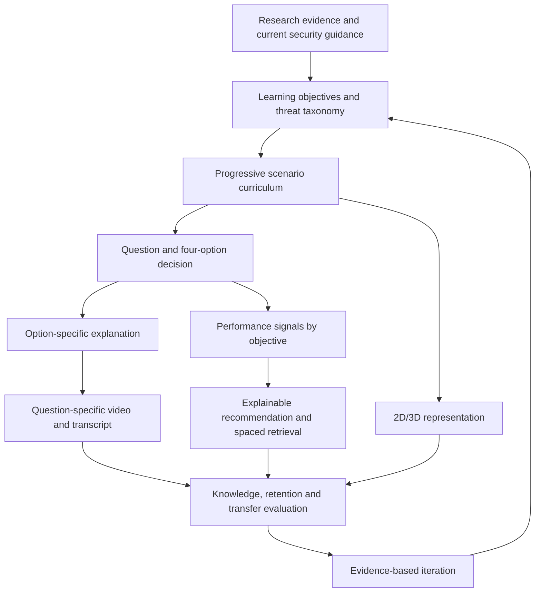

# Research-to-Feature Map

This document gives the reasoning chain from evidence to engineering requirement. Full question-level IDs are in `traceability-matrix.csv`.

## 1. Evidence-to-design chain

| Research citation | Research finding (bounded summary) | Identified design problem | Learning objective | Application feature | Evaluation |
|---|---|---|---|---|---|
| [1] NIST SP 800-50r1 | Learning programmes should use a lifecycle, address behaviour change and be measured/improved | One-off content does not support continuing learning | Apply safe practices and revisit weak areas | Progressive curriculum, learning history, spaced revision, analytics | Delayed retention and programme iteration metrics |
| [3] Puhakainen & Siponen | Theory-based active processing and ongoing communication supported policy-compliance training in an action-research context | Passive delivery can fail to engage systematic processing | Explain why an action is safe, not only what action is expected | Scenario decisions and option-specific rationales | Novel scenarios, rationale quality, qualitative feedback |
| [4], [5] Parsons et al. | Knowledge, attitudes and behaviour are distinct; HAIS-Q scores were related to lab phishing performance in one validation study | Quiz knowledge and real decisions must not be conflated | Distinguish indicators and choose a safe response | Baseline/posttest plus scenario assessment; dashboard caveat | Validated/adapted measure plus simulated task |
| [6] Kumaraguru et al. | Embedded anti-phishing education studied attention, retention and transfer | Explanations should be close to the decision and memorable | Identify phishing indicators and transfer to new messages | Question-level explanation and follow-up item | Delayed and transfer tests |
| [7] Liu et al. | Large field RCT found limited practical effect for annual and embedded training formats | Completion/click metrics alone can overstate programme value | Demonstrate learning beyond exposure and completion | Novel-scenario tasks, delayed retrieval, progress evidence | Controlled comparison and transfer assessment |
| [8], [9], [21] Game-based reviews | Serious games/gamification are established; methods and evaluations vary | Reward mechanics can obscure weak learning evidence | Practice defensively in a purposeful scenario | Game progression, achievement system, explicit instructional objectives | Compare against matched non-3D/non-gamified condition; report UX separately |
| [10], [11] Existing platforms/prototypes | Virtual labs, AR and feedback-based games have been explored | CYBERAWARE 3D must define a complementary use case | Explain attack consequences and defensive decision chains | Browser-first scenario simulation; selective 3D | Content-matched 2D/3D evaluation |
| [12] Immersive VR review | IVR can support active, practical learning in some contexts | Browser 3D benefits are not established by IVR findings | Visualize spatial/risk relationships | Interactive network/trust-boundary scene with 2D equivalent | Matched 2D/3D comparison and cognitive-load assessment |
| [13], [14] AI teaching-video evidence | AI videos may achieve similar short-term learning in an adjacent subject; review notes social-presence/motivation limitations | AI video can be efficient but must be reviewed | Explain one concept accessibly | Video per question with captions, transcript and written fallback | Video-plus-text versus text-only condition |
| [15] GenAI cybersecurity mapping | AI is used for content, scenario and tutoring tasks; hallucination, factuality and validation concerns remain | Unreviewed generated security content can mislead | Learn only validated defensive guidance | Human approval, source-grounded prompts, versioned content pipeline | Expert review and factual audit |
| [16] NIST SP 800-63B-4 | Manual OTP entry is not phishing-resistant; authentication fatigue is a documented attack pattern | MFA education must distinguish types and risks | Refuse unexpected approvals; prefer phishing-resistant options where available | Fictional MFA/OTP simulations | Scenario correctness and rationale |
| [17]–[20] NIST/OWASP/W3C | Frameworks cover risk governance, secure development, app risk and accessibility | The learning platform itself must meet security/accessibility requirements | Understand basic risk principles and use a safe platform | Secure architecture, WCAG 2.2 target, CI checks | SAST/dependency/secret scans, accessibility audit, test evidence |
| [25]–[38] CISA, FBI, FTC, NSA and NIST operational guidance | Official guidance describes defensive responses for phishing, BEC, QR scams, incident response, synthetic-media impersonation, public wireless, insider risk, patching, ransomware, PII and supplier risk | Learners need actionable, current responses grounded in authoritative guidance | Verify suspicious requests, protect identity and data, report incidents, prioritize response and govern third-party access | Question-level scenarios and explanations reference mapped primary guidance | Expert reference audit, citation-resolution checks and novel-scenario decision assessment |
| [25]–[38] CISA, FBI, FTC, NSA and NIST operational guidance | Official guidance describes defensive responses for phishing, BEC, QR scams, incident response, synthetic-media impersonation, public wireless, insider risk, patching, ransomware, PII and supplier risk | Learners need actionable, current responses grounded in authoritative guidance | Verify suspicious requests, protect identity and data, report incidents, prioritize response and govern third-party access | Question-level scenarios and explanations reference mapped primary guidance | Expert reference audit, citation-resolution checks and novel-scenario decision assessment |

## 2. Conceptual relationship

## 3. Traceability identifier rules

- Question: `PHISH-B01`, `MFA-I03`, `INCIDENT-A05`.
- Explanation: `EXPL-PHISH-B01`.
- Video: `VIDEO-PHISH-B01`.
- Learning objective: `LO-PHISH-01`.
- Reference ID: numeric IEEE reference in `research-paper.md`, with full record in `references.bib`.

The question ID is the stable parent identifier. Explanation and video records must match the matrix and content manifest. A missing video file remains explicitly not generated; `ready` is allowed only after a media file exists, technical validation passes and human review is recorded.

## 4. Question-level traceability

`research/traceability-matrix.csv` contains 45 authored question records (15 per core level). Each row links the canonical question ID to its learning objective, category, scenario, explanation ID, video ID, verified numbered source IDs and a proposed evaluation method. Question-bank status is `full_draft`; question-level video status is `script_storyboard_caption_draft`. The complete options and rationales are in `content/questions/question-bank.json`. Each item has a matching narration script, five-scene storyboard, generation prompt and WebVTT captions. Narrations explicitly explain the correct choice and each incorrect option. Human SME/instructional-design approval and rendered MP4 files remain pending.

## 7. Machine-readable traceability register

`traceability-matrix.csv` contains 45 authored item drafts: 15 Beginner, 15 Intermediate and 15 Advanced. Every row links a complete question ID to an explanation ID, unique video ID, source IDs, and a proposed evaluation method.

**Status semantics:**
- `question_bank_status=full_draft`: complete item text, options, correct answer and rationales are authored; this is not equivalent to independent subject-matter approval.
- `video_status=script_storyboard_caption_draft`: script, storyboard, prompt and caption draft exist; no MP4 is claimed.
- `video_file_path` is blank: no rendered media file exists.

A later release must not change the stable IDs without a migration record. The current validator requires every complete question to have exactly one explanation and one video manifest record, and every reference ID to resolve to a numbered manuscript item, a matching BibTeX key and a reference-registry entry. It also cross-checks the script, storyboard, captions and traceability row.

## Expert Challenge extension (Phase 5)

| Scenario ID | Learning objective | Feature | Evidence references | Explanation/video mapping | Review status |
|---|---|---|---|---|---|
| IR-E01 | Containment, evidence preservation and response ownership | Incident command decision scenario | [17], [28] | EXPL-IR-E01 / VIDEO-IR-E01 | Draft; human review pending |
| SUP-E02 | Supplier vulnerability prioritization using asset exposure and criticality | Supply-chain risk scenario | [17], [18], [37] | EXPL-SUP-E02 / VIDEO-SUP-E02 | Draft; human review pending |
| INS-E03 | Evidence-led insider-risk response with privacy safeguards | Insider-risk governance scenario | [32], [33], [38] | EXPL-INS-E03 / VIDEO-INS-E03 | Draft; human review pending |
| BEC-E04 | Independent payment-change verification and separation of duties | BEC financial-control scenario | [17], [26] | EXPL-BEC-E04 / VIDEO-BEC-E04 | Draft; human review pending |
| GOV-E05 | Board briefing with verified facts, unknowns and accountable decisions | Governance and risk communication scenario | [17], [28] | EXPL-GOV-E05 / VIDEO-GOV-E05 | Draft; human review pending |
| REC-E06 | Clean recovery source validation and monitored service restoration | Ransomware resilience scenario | [28], [35] | EXPL-REC-E06 / VIDEO-REC-E06 | Draft; human review pending |

The Expert Challenge is a separate optional module and does not change the core bank's 45-question acceptance count. Its unlock rule is a product heuristic based on at least 10 Advanced first attempts with at least 75% accuracy; it is not a validated competence threshold.

## Phase 6 — Interactive simulation traceability

| Simulation | Learning objective | Supporting source IDs | Question anchors | Application implementation | Validation method |
|---|---|---|---|---|---|
| Phishing inspection | Distinguish sender, urgency, destination and credential-request signals from weak visual cues | [1], [6], [7], [25] | PHISH-B01, SENDER-B02, LINK-B03 | `frontend/src/simulations.js` (`PHISHING_INDICATORS`) + `renderPhishingTask` | Exact-set decision model; four positive indicators and two neutral details tested |
| Password security lab | Configure a long, unique, manager-stored credential and MFA without collecting a real secret | [1], [16] | PASS-UNIQ-B04, PASS-MGR-B05, OTP-B06 | `scorePasswordProfile` + `renderPasswordTask` | Four profile checks; safe initial profile and all-pass profile unit-tested; no password input |
| MFA fatigue response | Deny/report unexpected authentication prompts, then secure the account and preserve event context | [16], [25] | MFA-FATIGUE-I05, ATO-I07, RESET-I13 | `MFA_STEPS` + `renderDecisionSteps` | Each of three decision stages has exactly one safe answer; feedback/retry flow tested at model level |
| Incident response command | Prioritize containment, escalation and evidence preservation during ransomware | [17], [28], [35] | IR-PRIORITY-A05, RANSOM-A12, LOGS-A10 | `INCIDENT_STEPS` + `renderDecisionSteps` | The unique safe action sequence is asserted by unit tests |

The WebGL wireframe scene is an explanatory visual, not the learning assessment itself. All decision inputs are semantic HTML controls and remain usable when WebGL is unavailable. This mapping records the design rationale; it is not evidence that the simulations improve retention or real-world behavior.
